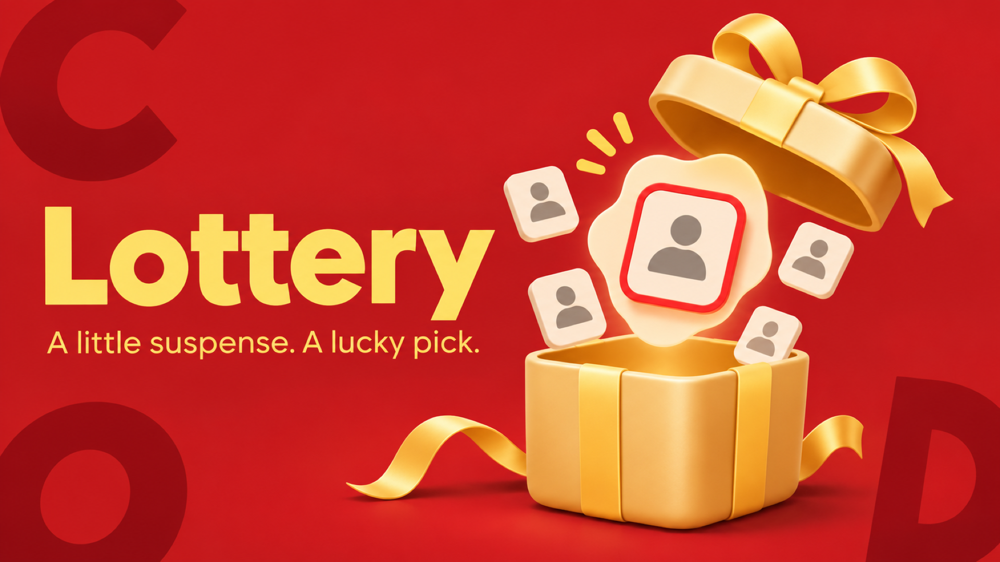

# 抽奖 Lottery

一个 Figma 抽奖插件。用画布上的人员卡片管理候选名单，观看红框跳动，按轮次保留中奖结果。

[在 Figma Community 中查看](https://www.figma.com/community/plugin/1173275512262750924/lottery)



## 使用

1. 打开「抽奖 Lottery」，右上角可切换中文或英文，语言选择会保留。
2. 点击礼物按钮。如果当前页没有人员卡片模板，会弹出初始化确认框。
3. 确认后新建「抽奖 / Lottery」页面，包含逐行中英双语说明、卡片主组件与 36 个示例人员。取消不会修改画布。
4. 编辑人员卡片的姓名、描述和 Avatar 图片填充。复制卡片实例时，直接放在页面上，不要放入组或画板。
5. 调整人数，再次点击礼物按钮。红框会在候选卡片间跳动，最后将中奖卡片移入分轮结果框。

默认抽取 2 人，最少 1 人。中奖人员不再参与后续轮次。候选人数不足时会提示；切换页面或关闭插件会取消正在进行的抽奖并清理选择框。

背景 COD 使用已发布版本的三个自定义 SVG。打开时随机散开；悬停时收拢到中心；移出时散开；按下时再次收拢；松开时重新散开。没有循环旋转动画。按钮悬停缩至 90%，按下缩至 50%。开启系统减少动态效果时，跳过运动过渡。

## 本地开发

在 Figma 中选择 Plugins → Development → Import plugin from manifest…，打开本目录的 `manifest.json`。无需安装依赖或构建。

插件 ID：`1173275512262750924`，对应已发布版本。没有子命令菜单，插件直接打开面板。无需网络访问。

- `code.js`：初始化、页面验证、随机抽样、画布动画和结果保存。
- `ui.html`：300×225 面板、背景微移动、语言切换与初始化对话框。没有 footer。
- `manifest.json`：插件配置。
- `test.cjs`：随机抽样与轮次检查。
- `test-ui.cjs`：原版鼠标交互顺序、SVG、尺寸与缓动检查。
- `assets/gift.svg`、`assets/cod-*.svg`：原版界面 SVG。
- `assets/lottery-logo-128.png`：128×128 发布图标。
- `assets/lottery-preview-1920x1080.png`：1920×1080 发布预览图。
- `assets/prompts.txt`：发布素材生成提示词。

## 实现

使用部分 Fisher–Yates 洗牌与 `Math.random` 进行无放回抽样。当前页中主组件名为 `personCardComponent` 的顶层实例构成候选池，兼容此前生成的人员卡片。中奖实例保留原有文本和图片覆盖。

人员卡片为 120×200；新卡片为双语文字预留了高度，头像区域为 108×132。结果框使用自动布局，内边距 20，卡片间距 10。轮次保存在页面插件数据中，并兼容已有结果框的轮次命名。

## 验证

```sh
node test.cjs
node test-ui.cjs
```

覆盖 3,600 次抽样的唯一性、输入不变性、连续轮次不重复、参数边界和历史轮次读取。已在 Figma 实测：单入口、初始化确认与取消、中英切换与重启后保留、逐行双语页面、红框动画、动画结束清理，以及动画中切页取消且不增加结果。

界面基准：红色 `#D82C2C`，按钮与结果框黄色 `#FFDD78`，礼物描边 `#7E0000`，COD 填充 `#150000`、不透明度 0.1。按钮过渡 0.5 秒，COD 过渡 0.4 秒，均使用 `cubic-bezier(0, .6, .5, 1)`。原版未启用的粒子、涟漪和彩色主题切换不在运行效果中。
